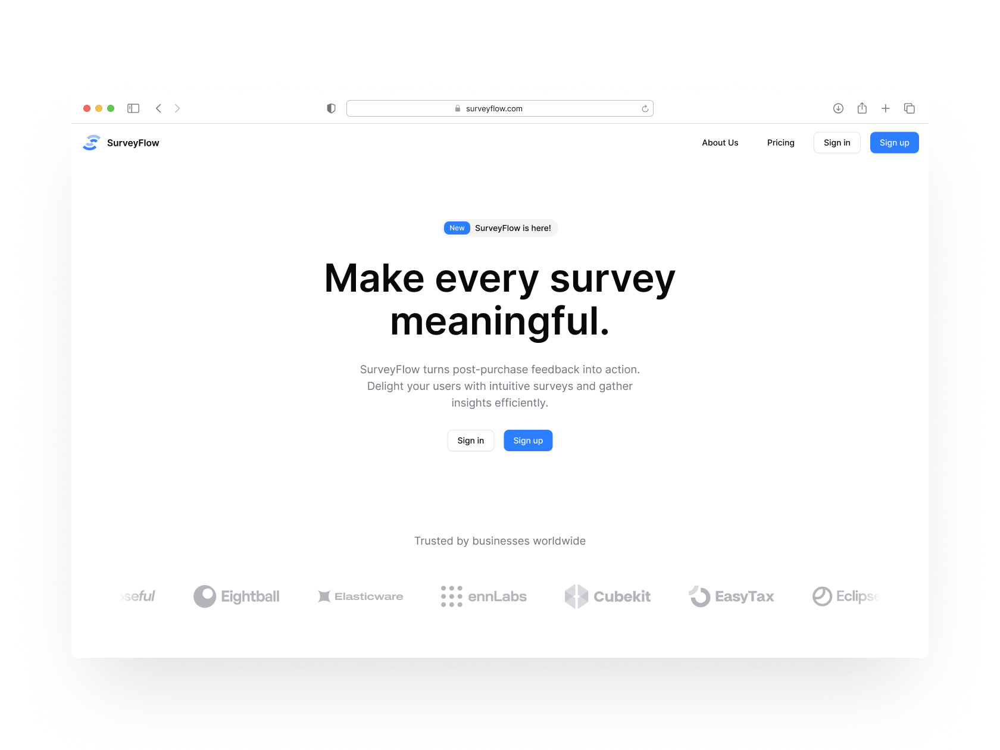

# SurveyFlow

**SurveyFlow** - a mobile-first survey builder and data-collection platform that helps you create engaging surveys, collect responses in real time, and analyse results with ease.

## Overview

SurveyFlow began as a no-code project in Bubble.io five years ago, aimed at making post-purchase surveys simpler. In 2025 I rebuilt it from the ground up to provide a modern, mobile-first experience using Next.js, Convex, and Clerk. The rebuild focuses on performance, polish, and real-time interactions while integrating subscriptions via Clerk's Stripe integration.

This repository contains the code for the rebuilt application: frontend, Convex backend logic, and integrations for authentication and billing.

---

## Features

- Mobile-first survey builder with a clean, minimal UI
- Real-time responses and live analytics (via Convex)  
- Authentication and user management with Clerk  
- Subscription billing using Stripe (integrated via Clerk)  
- Deployed on Netlify for fast global performance

---

## Tech stack

- Framework: Next.js (App Router)  
- Language: TypeScript  
- Styling: TailwindCSS  
- Realtime / Backend: Convex  
- Auth & Billing: Clerk (Clerk ↔ Stripe subscription integration)  
- Hosting: Netlify

---

## Demo

- [Live demo](https://surveyflow-demo.netlify.app/)
- [Figma design](https://www.figma.com/design/9mp25a2iEFfIIs7lBL265M/%E2%AD%90%EF%B8%8F-SurveyFlow---Kelsie-Murphy-s-Portfolio)

---

## Getting started (local development)

### Prerequisites

- Node.js (recommended latest LTS)  
- npm, pnpm or yarn (I used pnpm)
- A Clerk account (for auth)  
- A Convex project (or local Convex dev setup)  
- A Stripe account if you want to test subscriptions (optional for basic local usage)

### 1. Clone repository

    git clone https://github.com/kelsiesmurphy/surveyflow.git  
    cd surveyflow

### 2. Install dependencies

    npm install  
    # or  
    yarn  
    # or  
    pnpm install

### 3. Create environment variables

Create a `.env.local` file in the project root and add the following environment variables (replace values with your real keys):

    # Clerk
    NEXT_PUBLIC_CLERK_SIGN_IN_URL=/sign-in
    NEXT_PUBLIC_CLERK_SIGN_UP_URL=/sign-up
    NEXT_PUBLIC_CLERK_PUBLISHABLE_KEY=pk_XXXX
    CLERK_SECRET_KEY=sk_XXXX
    CLERK_FRONTEND_API_URL=https://your-clerk-account.clerk.accounts.dev

    # Convex
    CONVEX_DEPLOYMENT=dev:XXXX # team: XX, project: XX
    NEXT_PUBLIC_CONVEX_URL=https://your-convex-deployment.convex.cloud
    NEXT_PUBLIC_CONVEX_SITE_URL=https://your-convex-deployment.convex.site

    # Misc
    NEXT_PUBLIC_APP_URL=http://localhost:3000

Notes & tips:  

- Configure Clerk in the Clerk dashboard; add your app origin (`http://localhost:3000`) to allowed origins and set up the required redirect URLs.  
- For Stripe subscription integration, Clerk can handle the Stripe connection - follow Clerk's dashboard instructions for connecting your Stripe account (the app will rely on Clerk to manage subscription workflows).  
- If you run Convex locally, ensure the local Convex URL is set and the Convex dev server is running.

### 4. Start Convex (optional, if using local dev)

    npx convex dev

(Refer to Convex docs for installation and local dev commands if needed.)

### 5. Run the development server

    npm run dev  
    # or  
    yarn dev  
    # or  
    pnpm dev

Then open http://localhost:3000 in your browser.

---

## Scripts

Scripts in `package.json`:

- dev - Start development server  
- build - Build for production  
- start - Start the production server after build  
- lint - Run linting  
- test - Run tests

Example usage:

    pnpm run build  
    pnpm run dev

---

## Data & Security considerations

- Authentication and session security are handled by Clerk. Keep Clerk and Stripe keys private and never commit them to source control.  
- Convex stores application data - follow Convex security best practices for access control and data rules.

---

## Troubleshooting

- **Auth errors:** Confirm Clerk keys and that the app origin (localhost/prod) is allowed in Clerk dashboard.  
- **Convex issues:** If you see backend errors, verify CONVEX_DEPLOYMENT / local Convex dev server is running and accessible.  
- **Stripe subscriptions not creating:** Ensure the Clerk → Stripe integration is configured correctly in Clerk's dashboard and the relevant API keys are set.

---

## Author & Contact

### Kelsie Murphy

- Portfolio: https://kelsiesmurphy.com  
- GitHub: https://github.com/kelsiesmurphy  

---

**Thanks for checking out SurveyFlow!**
